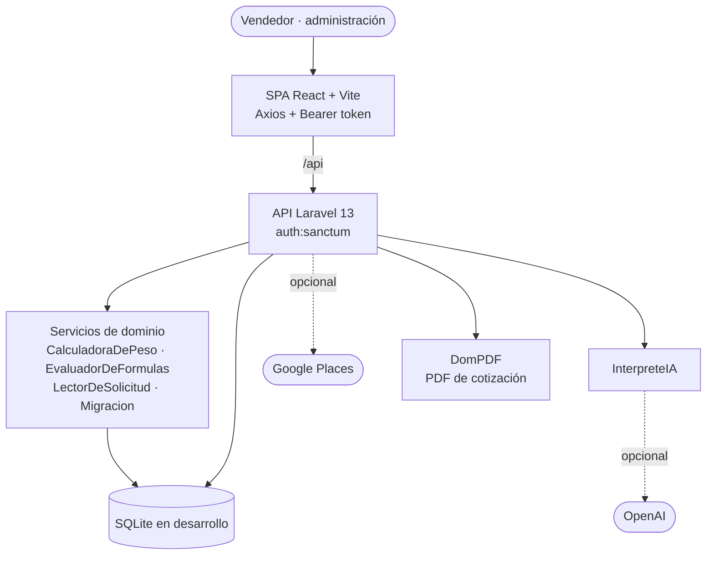
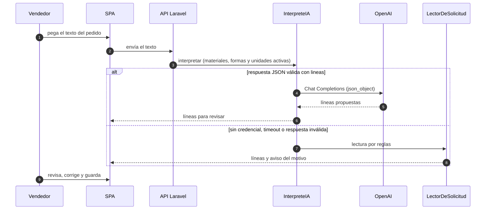
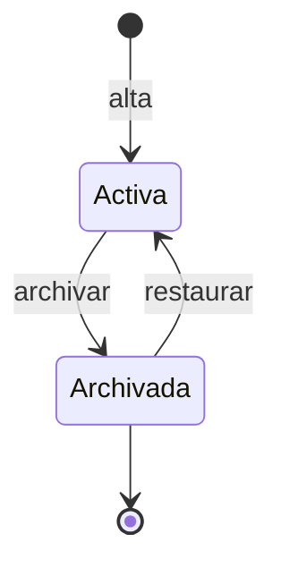
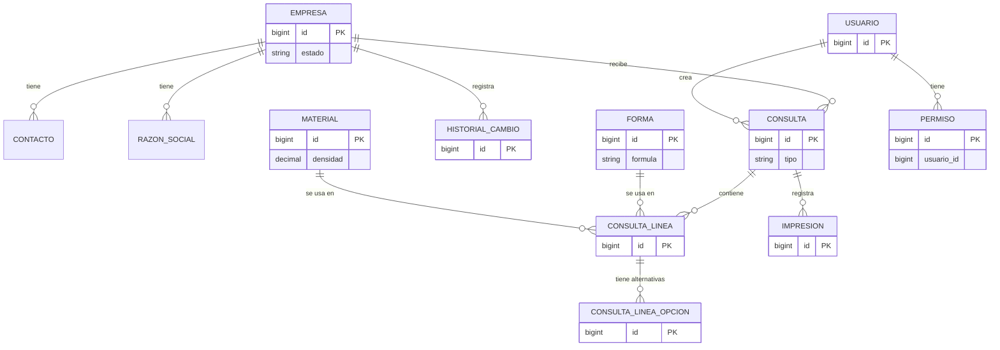

<div align="center">

<br/>

**Sistema interno de cotizaciones: cálculo de peso por fórmula, permisos por usuario, historial de cambios y lectura asistida por IA del pedido.**


<br/>


</div>


## 📑 Contenido

- [El problema](#-el-problema)
- [La solución](#-la-solución)
- [Funcionalidades](#-funcionalidades)
- [Arquitectura](#%EF%B8%8F-arquitectura)
- [Flujos de trabajo](#-flujos-de-trabajo)
- [Modelo de datos](#%EF%B8%8F-modelo-de-datos)
- [Criterios y decisiones](#-criterios-y-decisiones)
- [Stack](#%EF%B8%8F-stack)
- [Estructura del repo](#%EF%B8%8F-estructura-del-repo)
- [Puesta en marcha](#-puesta-en-marcha)
- [Pruebas y calidad](#-pruebas-y-calidad)
- [Despliegue](#-despliegue)
- [Estado y pendientes](#-estado-y-pendientes)
- [Licencia y autoría](#-licencia-y-autoría)


## 🧩 El problema

Cotizar un caño o un producto metálico exige calcular el peso a partir del material, la forma y las medidas, y luego transcribir cada línea del pedido del cliente. Esa transcripción es lenta y propensa a errores de tipeo. Además, las condiciones pactadas con cada empresa y el precio de cada cotización se perdían en el historial del sistema anterior, y no había control de quién veía qué.

## 💡 La solución

Un sistema a medida que reemplaza al anterior: el vendedor carga la cotización con líneas calculadas por fórmula, puede pedir a la IA que lea el texto del pedido del cliente, y el sistema guarda una copia de todo lo que se usó en el cálculo. Administración y vendedores trabajan cada uno con sus permisos.

| Usuario | Qué hace |
|---|---|
| **Vendedor** | Carga cotizaciones, gestiona fichas de empresas y contactos, consulta historial y condiciones pactadas. |
| **Administración** | Mantiene el catálogo de materiales, formas y fórmulas, y controla los permisos por usuario y por ficha. |

El sistema es de una sola empresa, con permisos por usuario y por ficha; no es multi-tenant.


## ✨ Funcionalidades

<details open>
<summary><b>Empresas y contactos</b></summary>

- Alta, edición, archivado y restauración de empresas, con contactos, razones sociales, enlaces (web, redes, mapa) y campos propios.
- Autocompletado de direcciones con Google Places, opcional y con clave del lado del servidor.
- Visibilidad de una ficha puntual para usuarios concretos.

</details>

<details open>
<summary><b>Cotizaciones</b></summary>

- Carga de líneas, alternativas de línea, condiciones comerciales y observaciones.
- Copia de cotizaciones anteriores y consultas relacionadas.
- Cálculo de peso por fórmula: material (densidad), forma (fórmula) y medidas.
- Interpretación del texto del pedido con IA (OpenAI), con lector de reglas propio como respaldo.
- PDF de la cotización con registro de cada impresión o envío (vía, contacto y fecha).

</details>

<details open>
<summary><b>Administración</b></summary>

- Permisos por usuario: ver importes, ver notas de otros, control de cambios y capacidad de modificar, imprimir o archivar.
- Historial de cambios automático sobre los modelos principales: campo, valor anterior y nuevo, quién y cuándo.
- Migración de datos del sistema anterior (materiales, empresas), con listado de materiales sin densidad cargada.
- Resumen numérico para la pantalla de inicio y sugerencias de alternativas según el historial.

</details>


## 🏗️ Arquitectura

<p align="center">
  
</p>

Arquitectura desacoplada: una SPA en React consume una API REST de Laravel autenticada por token. Las pantallas de negocio no se renderizan en el servidor; `routes/web.php` solo sirve la página de bienvenida por defecto.



No hay colas propias del dominio más allá de las tablas que Laravel crea por defecto (`jobs`, `cache`).


## 🔄 Flujos de trabajo

### Interpretación de un pedido con IA

La IA solo propone líneas. Si no hay credencial o la respuesta no sirve, el lector de reglas toma el texto y la carga no se bloquea.



### Estados de una empresa




## 🗃️ Modelo de datos

Eloquent con `$guarded = []` en los modelos de dominio; los formularios validan explícitamente en los controladores.



Un trait (`RegistraCambios`) escribe en `historial_cambios` cada alta, modificación o archivado. Las líneas de cotización guardan una copia de la densidad, la fórmula y el factor usados, para que una corrección posterior del catálogo no altere cotizaciones ya emitidas.


## 🧭 Criterios y decisiones

| Decisión | Por qué |
|---|---|
| **Evaluador de fórmulas propio, sin `eval()`** | Las fórmulas son datos editables, así que se tokenizan y solo admiten números, medidas, `+ - * / ^` y una lista cerrada de funciones. |
| **Auditoría por trait** | `RegistraCambios` se engancha a los eventos de Eloquent en vez de repetir el registro en cada controlador. |
| **Copia de datos en cada línea** | Una cotización emitida no cambia si el catálogo se corrige después. |
| **Lector determinístico + IA opcional** | La IA solo interviene en la lectura del texto de entrada, nunca en el cálculo. Sin credencial, el sistema sigue funcionando. |
| **Token Sanctum en vez de cookies entre orígenes** | Simplifica CORS: `supports_credentials: false` y `allowed_origins` limitado al `FRONTEND_URL`. |

**Seguridad, en resumen:**

- Todas las rutas de negocio de `routes/api.php` están bajo `auth:sanctum`, salvo el login.
- Autorización por usuario y por ficha; un administrador siempre ve todo, y no puede quedarse sin permisos.
- Entradas validadas con `Request::validate()` y reglas de Laravel en cada escritura.
- Secretos por variables de entorno. Las claves de OpenAI y de Google Places son opcionales.
- Cada impresión o envío de PDF queda registrado con usuario, vía y destinatario.
- No se encontró limitación de tasa personalizada ni cabeceras CSP explícitas en el código revisado.


## 🛠️ Stack

| Capa | Tecnología | Versión |
|---|---|---|
| Backend | PHP · Laravel | 8.3 o superior · 13 |
| Autenticación | Laravel Sanctum | 4 |
| PDF | Barryvdh DomPDF | 3 |
| Frontend | React · TypeScript · Vite | 19 · strict · 8 |
| Enrutado y HTTP | React Router · Axios | 7 · — |
| Estilos | Tailwind CSS | 4 |
| Datos | SQLite (`database/database.sqlite`) | — |
| IA (opcional) | OpenAI Chat Completions | `OPENAI_MODEL` |
| Direcciones (opcional) | Google Places API (New) | — |
| Pruebas | PHPUnit | 12 |


## 🗂️ Estructura del repo

```text
backend/
├── app/Http/Controllers/     empresas, consultas, autenticación, permisos, PDF, migración
├── app/Models/               Empresa, Consulta, Forma, Material, Permiso, HistorialCambio…
├── app/Models/Concerns/      RegistraCambios (auditoría automática)
├── app/Services/             CalculadoraDePeso, EvaluadorDeFormulas, InterpreteIA, LectorDeSolicitud
├── database/migrations/      esquema
├── routes/api.php            rutas de negocio (auth:sanctum)
└── tests/Feature/            suite principal
frontend/
├── src/pages/indice/         empresas, cotizaciones, formas, permisos, control de cambios
├── src/components/           barra lateral, calculadora de peso, buscador de direcciones
└── src/lib/                  cliente de la API, autenticación, calculadora
```


## 🚀 Puesta en marcha

Requisitos: PHP 8.3 o superior, Composer, Node.js y npm.

```bash
# backend
cd backend
composer install
cp .env.example .env
php artisan key:generate
touch database/database.sqlite
php artisan migrate
npm install

# frontend (en otra terminal)
cd frontend
npm install
cp .env.example .env     # ajustar VITE_API_URL si el backend no corre en localhost:8002
```

- Para levantar todo junto desde `backend`: `composer run dev` (servidor PHP, cola, logs y Vite).
- Por separado: `php artisan serve` en el backend y `npm run dev` en el frontend.
- Opcional: `OPENAI_API_KEY` y `GOOGLE_PLACES_KEY` en `backend/.env`. Sin ellas el sistema funciona con el lector de reglas.
- Nunca se commitean los `.env` reales.


## 🧪 Pruebas y calidad

```bash
cd backend && php artisan test
cd frontend && npm run lint
```

- Suite de backend en `backend/tests/Feature`: cálculo de peso y paridad con el sistema anterior, fórmulas rotas, factor por unidad, condiciones de la cotización, alternativas, formas, caños estándar, interpretación por IA y resumen.
- El README anterior registraba **150 pruebas y 1096 aserciones en verde**. **No se volvió a ejecutar para esta versión.**
- Lint del frontend con oxlint (`npm run lint`). No hay suite automatizada de frontend ni CI en el repositorio.


## 🐳 Despliegue

No hay Docker, Docker Compose ni CI/CD configurados en el repositorio. Para desarrollo se usa SQLite y el servidor embebido de Laravel con Vite. **No hay despliegue productivo documentado en el repositorio.**


## 📌 Estado y pendientes

- Último commit: **12-11-2026** (`cd1f5c0`, aviso de versión nueva en la pantalla y actualización automática cuando es posible).
- Sistema en desarrollo activo. Sin evidencia en el repositorio de despliegue en producción.
- Repositorio hermano del sitio corporativo: [Roberto-cordes](https://github.com/santiagoAbasto/Roberto_cordes).


## 📄 Licencia y autoría

Desarrollado por el **Ing. Santiago Abasto**.


Sistema de uso interno del cliente. El repositorio no incluye archivo de licencia. Los archivos comerciales del cliente (planillas, PDFs e informes) no se versionan y quedan fuera del repositorio junto con los respaldos de la base.
